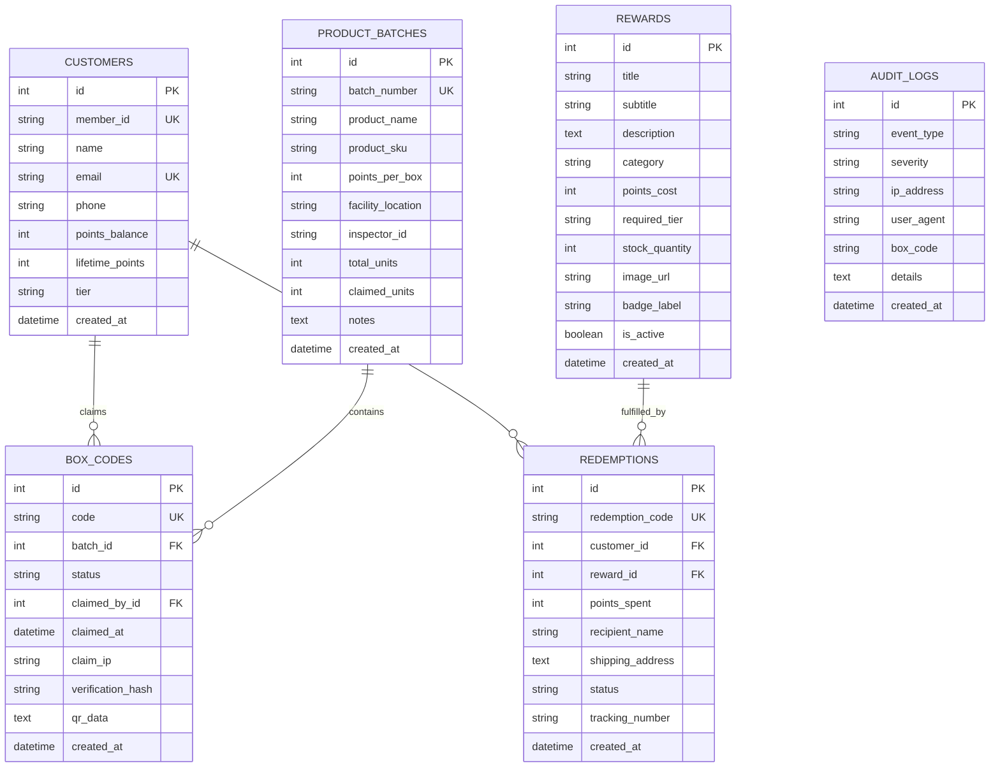
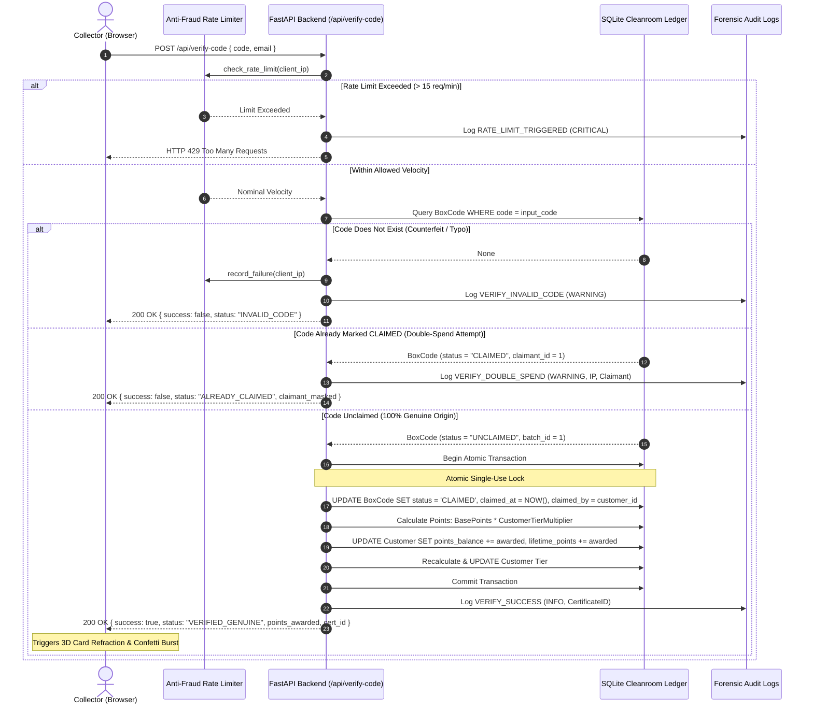

# PRISM VAULT // Architectural Blueprint & Data Model

This document outlines the technical architecture, component stack rationale, database schema, and operational lifecycle of **PRISM VAULT**.

---

## 1. Stack Choice Rationale

```
+-----------------------------------------------------------------------------------+
|                                 CLIENT LAYER                                      |
|  Vanilla HTML5 + Advanced CSS3 (Liquid Quartz) + Vanilla ES6+ JS + Web Audio API  |
+-----------------------------------------------------------------------------------+
                                         │ (HTTPS / JSON REST)
                                         ▼
+-----------------------------------------------------------------------------------+
|                                FASTAPI APPLICATION                                |
|  - Anti-Fraud Sliding Window Rate Limiter                                         |
|  - Cryptographic Signature Engine (HMAC-SHA256)                                   |
|  - High-DPI QR Label Generator (Pillow / qrcode)                                  |
|  - Pydantic v2 Request/Response Validation                                        |
+-----------------------------------------------------------------------------------+
                                         │ (SQLAlchemy ORM)
                                         ▼
+-----------------------------------------------------------------------------------+
|                               DATABASE LAYER (SQLITE)                             |
|  - Atomic Single-Use Code Locks                                                   |
|  - Indexed Serials & Event Auditing                                               |
+-----------------------------------------------------------------------------------+
```

### Why FastAPI (Python 3.10+)?
- **Async Execution & High Throughput**: Essential for handling concurrent verification requests during factory product release drops.
- **Native Pydantic v2 Validation**: Enforces strict payload contracts, automatic type casting, and clear error diagnostics with zero manual boilerplate.
- **Interactive Documentation**: Instant auto-generation of OpenAPI and Swagger UI (`/docs`), enabling factory partners to integrate automated box-labeling robotic systems.

### Why SQLite with SQLAlchemy 2.0?
- **Zero External Dependencies**: Embedded serverless database running in-process; eliminates external network latency and daemon setup for factory cleanroom appliances.
- **ACID Transactional Guarantees**: Guarantees atomic single-use box code claiming—critical to prevent double-spending race conditions.
- **Portability**: The entire factory ledger and historical certificates can be snapshotted or backed up by copying a single `.db` file.

### Why Vanilla ES6+ & Advanced CSS3 ("Liquid Quartz")?
- **Zero Build Tool Overheads**: No Webpack, Vite, or Node.js runtime required. Pages load instantaneously with sub-millisecond first contentful paint (FCP).
- **GPU-Accelerated Visual Identity**: Hardware-accelerated CSS transforms (`perspective: 1200px`, `backdrop-filter: blur(28px)`) ensure buttery 60fps 3D card parallax and specular glares on any desktop or mobile browser.
- **Native Web Audio API**: Procedural sound generation eliminates external audio asset downloads, network latency, and licensing issues.

---

## 2. SQLite Relational Data Model



### Table Definitions & Field Specifications

#### `customers`
Stores registered collectors and accrued lifetime rewards.
- `id` (INTEGER, PK): Internal surrogate key.
- `member_id` (VARCHAR(32), UNIQUE, INDEXED): Alphanumeric collector identifier (e.g. `PV-MEM-88219`).
- `name` (VARCHAR(120)): Full collector name.
- `email` (VARCHAR(160), UNIQUE, INDEXED): Primary account contact.
- `phone` (VARCHAR(40), NULLABLE): Contact phone number.
- `points_balance` (INTEGER): Current spendable Prism Points balance.
- `lifetime_points` (INTEGER): Cumulative earned points governing tier status.
- `tier` (VARCHAR(32)): Current rank (`Quartz`, `Sapphire`, `Amethyst`, `Obsidian`, `Prism Sovereign`).
- `created_at` (DATETIME): Registration timestamp.

#### `product_batches`
Represents factory manufacturing runs.
- `id` (INTEGER, PK): Batch ID.
- `batch_number` (VARCHAR(64), UNIQUE, INDEXED): Factory batch identifier (e.g. `BATCH-2026-CHRONO-A1`).
- `product_name` (VARCHAR(160)): Full commercial name.
- `product_sku` (VARCHAR(64)): Factory manufacturing SKU.
- `points_per_box` (INTEGER): Base points awarded per retail unit.
- `facility_location` (VARCHAR(120)): Production cleanroom / foundry location.
- `inspector_id` (VARCHAR(64)): Master cleanroom inspector identifier.
- `total_units` (INTEGER): Total boxes minted in this production run.
- `claimed_units` (INTEGER): Count of units verified and registered by consumers.
- `created_at` (DATETIME): Manufacturing timestamp.

#### `box_codes`
The physical box security tokens placed under the scratch-off foil.
- `id` (INTEGER, PK): Primary key.
- `code` (VARCHAR(64), UNIQUE, INDEXED): The 12-char serial code (e.g. `PV-CHRO-77B2-04`).
- `batch_id` (INTEGER, FK -> `product_batches.id`): Parent production batch.
- `status` (VARCHAR(32), INDEXED): `UNCLAIMED`, `CLAIMED`, `REVOKED`, `SUSPECT`.
- `claimed_by_id` (INTEGER, FK -> `customers.id`, NULLABLE): Claimant account.
- `claimed_at` (DATETIME, NULLABLE): Verification timestamp.
- `claim_ip` (VARCHAR(64), NULLABLE): Verifying IP address.
- `verification_hash` (VARCHAR(128)): Immutable HMAC-SHA256 signature.
- `qr_data` (TEXT): Base64 PNG data URI of printable label QR code.
- `created_at` (DATETIME): Minting timestamp.

#### `rewards`
Artisan catalog goods available for points redemption.
- `id` (INTEGER, PK): Primary key.
- `title` (VARCHAR(160)): Reward name.
- `description` (TEXT): Full specifications.
- `points_cost` (INTEGER): Prism Points required.
- `required_tier` (VARCHAR(32)): Minimum tier gate required.
- `stock_quantity` (INTEGER): Available inventory count.
- `is_active` (BOOLEAN): Catalog visibility flag.

#### `redemptions`
Customer reward orders awaiting factory dispatch.
- `id` (INTEGER, PK): Primary key.
- `redemption_code` (VARCHAR(40), UNIQUE, INDEXED): Fulfillment code (e.g. `RDM-7741-ALPH`).
- `customer_id` (INTEGER, FK -> `customers.id`): Purchasing customer.
- `reward_id` (INTEGER, FK -> `rewards.id`): Item redeemed.
- `points_spent` (INTEGER): Points deducted.
- `shipping_address` (TEXT): Physical delivery destination.
- `status` (VARCHAR(32)): `PENDING_SHIPMENT`, `IN_PRODUCTION`, `DISPATCHED`, `COMPLETED`.
- `tracking_number` (VARCHAR(64), NULLABLE): Courier tracking ID.
- `created_at` (DATETIME): Order timestamp.

#### `audit_logs`
Immutable forensic security ledger.
- `id` (INTEGER, PK): Primary key.
- `event_type` (VARCHAR(64), INDEXED): e.g. `VERIFY_SUCCESS`, `VERIFY_DOUBLE_SPEND`, `VERIFY_INVALID_CODE`, `RATE_LIMIT_TRIGGERED`.
- `severity` (VARCHAR(20)): `INFO`, `WARNING`, `CRITICAL`.
- `ip_address` (VARCHAR(64)): Source IP address.
- `box_code` (VARCHAR(64), NULLABLE): Target serial code.
- `details` (TEXT): JSON payload of event parameters.
- `created_at` (DATETIME, INDEXED): Timestamp.

---

## 3. End-to-End Verification Lifecycle

The following sequence diagram details the complete verification workflow, atomic single-use locking, tier multiplier calculation, and fraud defense paths.


